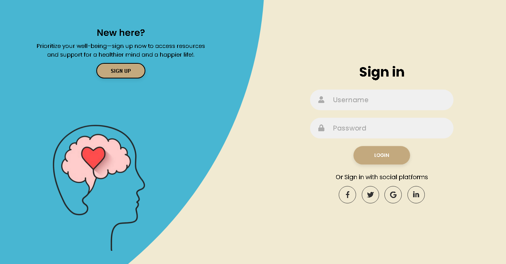
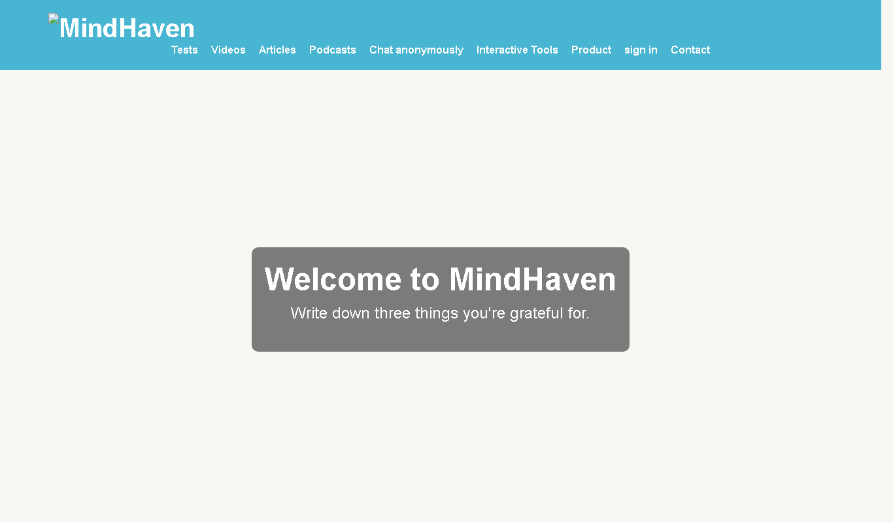
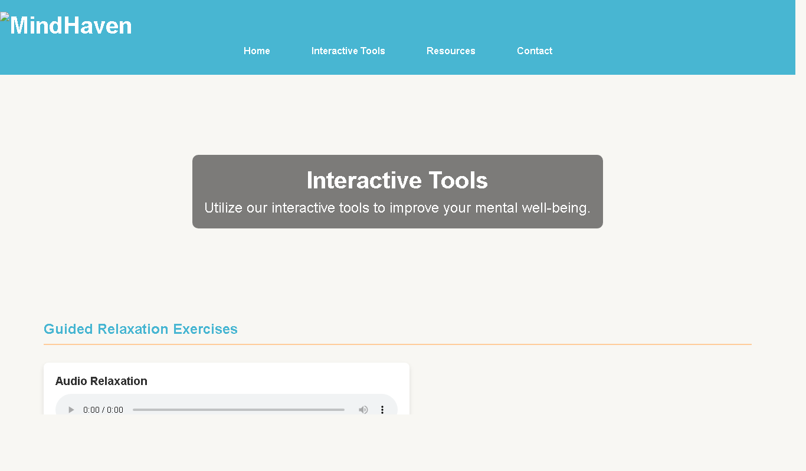

# MindHaven

**A safe place for your mind.** MindHaven is a mental health and well being website: it offers educational resources, relaxation tools, a private journal, self assessment tests, an anonymous community chat, access to professionals and a dashboard for doctors to follow their patients.

Built with **HTML, CSS and vanilla JavaScript**, with no framework and no server: open it in a browser and it works.



## Features

| Page | File | What it offers |
|---|---|---|
| Sign in and sign up | `login.html` | Account forms and social sign in buttons |
| Welcome and resources | `welcome.html` | Navigation to tests, videos, articles and podcasts, with a daily gratitude prompt |
| Interactive tools | `interactive.html` | Guided relaxation (audio and video), a digital journal saved in the browser, self assessment tests |
| Community support | `community.html` | Anonymous chat to talk with other members |
| Professional assistance | `profassistant.html` | List of professionals, appointment booking and emergency services |
| Doctor dashboard | `doctor.html` | Patient list, add and manage patients, add scores, patient report |
| Subscription | `subscription.html` | Monthly, 3 month and annual membership plans |
| Product | `home.html` | Product page |
| Contact | `contact.html` | Contact form |

## Screenshots

| Welcome | Interactive tools |
|:---:|:---:|
|  |  |

## Project structure

```
mindhaven/
|__ website/
|   |  login.html             Start page
|   |  welcome.html, interactive.html, community.html, doctor.html ...
|   |  *.css                  One stylesheet per page
|   |  *.js                   Page logic (forms, journal, chat, doctor dashboard)
|   |  *.jpg, *.png           Images
|   |__ media/                Relaxation music and video (add your own, see media/README.md)
|__ docs/                     Screenshots
```

## Quick start

```bash
git clone https://github.com/achrefslim/mindhaven.git
```

Open `website/login.html` in your browser. Full steps in [TUTORIAL.md](TUTORIAL.md).

## Possible improvements

1. Add a backend and a database so accounts, journal entries and patients are saved on a server
2. Real time chat with WebSockets for the community page
3. Responsive design for phones

## Author

[achrefslim](https://github.com/achrefslim)
